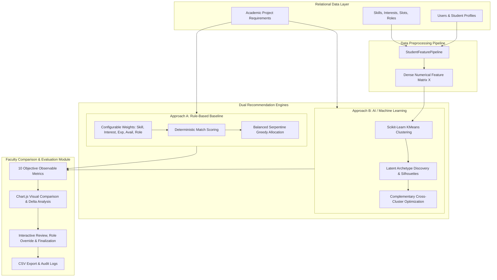

# AI Group Project Team Builder

An intelligent, full-stack academic team formation platform that creates balanced student project teams through multi-dimensional profile analysis, distinguishing a conventional **Rule-Based Baseline** from an **Unsupervised Scikit-Learn Machine Learning (K-Means)** archetype discovery and complementary assignment component.

Built for academic and college review evaluations with a complete comparison dashboard, role recommendations with explainability, manual faculty overrides, and automated verification suites.

---

## 1. Problem Statement & Objectives

In university computing and engineering courses, student group project teams are often formed through ad-hoc self-selection or random assignment. This typically leads to:
- **Skill concentration**: Top developers grouping together while other teams lack core competencies.
- **Role friction**: Teams with three backend developers and zero frontend or testing specialists.
- **Scheduling failure**: Teammates with conflicting availability unable to find meeting hours.
- **Black-box allocations**: Systems claiming "AI matching" without demonstrating how machine learning differs from ordinary weighted scoring.

**Objectives of AI Group Project Team Builder:**
1. Form balanced teams respecting project technical requirements, target team size, and role distribution.
2. Provide transparent, explainable assignment rationales for every student and team.
3. Allow faculty review, manual student reassignments, and role overrides before final publishing.
4. **Defend the machine learning component honestly**: Clearly separate the deterministic Rule-Based Baseline from the Scikit-learn K-Means model, evaluating both on the exact same eligible student cohort with observable mathematical metrics.

---

## 2. Architecture & System Flow



---

## 3. Technology Stack

- **Backend Web Framework**: Python 3.10+ with Flask 3.1 (Application Factory, REST Blueprints).
- **Relational Database**: MySQL 8.0+ via PyMySQL / SQLAlchemy 2.0 with automatic zero-configuration SQLite fallback.
- **Data Science & ML**: Scikit-Learn 1.7 (`KMeans`, `silhouette_score`), NumPy 2.2, Pandas 2.3, SciPy 1.15.
- **Model Persistence**: Joblib 1.5 (`.joblib` pipeline and cluster model serialization).
- **Frontend & UI**: HTML5, CSS3, Bootstrap 5.3, Bootstrap Icons, Chart.js 4.4 (responsive college interface).
- **Testing & Verification**: Pytest 9.1 with Flask Test Client.

---

## 4. Database Schema & Normalization

The system implements 19 normalized relational tables with foreign keys, cascaded deletions, and unique constraints:

- `users`: Core authentication, hashed passwords, and RBAC (`student`, `faculty`).
- `student_profiles`: Academic ID, department, experience level, experience years, portfolio summary, completion status.
- `skills`, `student_skills`: Technical skill catalog and student proficiency ratings (1-5).
- `interests`, `student_interests`: Domain interests catalog and student selections.
- `availability_slots`, `student_availability`: Time slot catalog and student meeting availability.
- `roles`, `student_preferred_roles`: Roles catalog and ranked student preferences (Rank 1, 2, 3).
- `projects`, `project_required_skills`, `project_required_roles`: Course project constraints, target team size, mandatory skills, and needed roles.
- `teams`, `team_members`, `role_assignments`: Generated team entities, assigned members, fit scores, and rationales.
- `model_runs`: Fitted K-Means model metadata, cluster count, Silhouette score, inertia, and file paths.
- `team_generation_runs`, `evaluation_results`: Execution run parameters, runtime, and the 10 computed evaluation metrics.

---

## 5. Dual Recommendation Methodologies

### Approach A: Rule-Based Baseline (Deterministic Heuristics)
Computes a linear weighted score normalized to $[0, 100]$:
$$\text{Score} = w_{\text{skill}} S_{\text{skill}} + w_{\text{int}} S_{\text{interest}} + w_{\text{exp}} S_{\text{exp}} + w_{\text{avail}} S_{\text{avail}} + w_{\text{role}} S_{\text{role}}$$
- **Default Weights**: Skill Match (40%), Interest/Domain (20%), Experience (15%), Availability (15%), Role (10%).
- **Validation**: Weights are verified to be non-negative and normalized ($\sum w_i = 1.0$).
- **Team Allocation**: Sorts candidates by baseline score, seeds team anchors, and greedily fills slots to maximize incremental required skill coverage while strictly enforcing requested team size.

### Approach B: AI / Machine Learning (Scikit-Learn K-Means)
A defensible unsupervised learning approach that operates without requiring fabricated historical performance labels:
1. **Feature Engineering**: Multi-hot technical skill vector scaled by proficiency ($\frac{p}{5.0}$), multi-hot binary interests, multi-hot availability slots, ranked role preferences ($\frac{1}{\text{rank}}$), and normalized experience.
2. **K-Means Clustering**: Fits Scikit-learn `KMeans(n_clusters=k, random_state=42)` on the feature matrix. Dynamically computes the Silhouette score and centroid peak features to discover human-interpretable archetypes:
   - *Backend & Systems Specialist*
   - *Frontend & UI/UX Specialist*
   - *Data Science & Machine Learning Specialist*
   - *DevOps, QA & Architecture Specialist*
3. **Cross-Cluster Complementary Recommendation**:
   Assembles teams by optimizing:
   - **Cluster Diversity Bonus**: Prioritizes candidates from unrepresented clusters ($+35.0$).
   - **Skill Complementarity**: Rewards orthogonal skill contributions that fill team deficits.
   - **Schedule Compatibility**: Maximizes Jaccard similarity of meeting availability slots.
4. **Explainability**: Every student assignment includes their discovered cluster archetype, primary skills contributed to the team, and role recommendation rationale.

---

## 6. Evaluation Metrics & Mathematical Formulas

The comparison dashboard computes actual metrics from generated teams without hardcoded claims:

1. **Skill Coverage Ratio**:
   $$\text{Mean}_{T \in Teams} \left( \frac{|\{s \in \text{ReqSkills} \mid \exists m \in T : \text{prof}(m, s) \ge \text{min\_prof}(s)\}|}{|\text{ReqSkills}|} \right)$$
2. **Average Student Skill Alignment**:
   $$\frac{1}{|N|} \sum_{m=1}^{N} \left( \frac{1}{|\text{ReqSkills}|} \sum_{s \in \text{ReqSkills}} \min\left(1.0, \frac{\text{prof}(m, s)}{\text{min\_prof}(s)}\right) \right)$$
3. **Interest & Domain Alignment**:
   $$\frac{1}{|N|} \sum_{m=1}^{N} \mathbb{I}(\text{interests}(m) \cap \text{domain\_keywords} \neq \emptyset)$$
4. **Availability Compatibility**:
   $$\text{Mean}_{T \in Teams} \left( \frac{2}{|T|(|T|-1)} \sum_{i < j \in T} \frac{|\text{Slots}_i \cap \text{Slots}_j|}{|\text{Slots}_i \cup \text{Slots}_j|} \right)$$
5. **Role Coverage Ratio**:
   $$\text{Mean}_{T \in Teams} \left( \frac{|\{r \in \text{ReqRoles} \mid \exists m \in T : \text{role}(m) = r\}|}{|\text{ReqRoles}|} \right)$$
6. **Constraint Satisfaction Rate**:
   $$\frac{\text{Count of teams meeting mandatory skill criteria and team size bounds}}{\text{Total Teams Formed}}$$
7. **Team Size Compliance**:
   $$\frac{|\{T \in Teams \mid \text{size}(T) = \text{desired\_size}\}|}{\text{Total Teams Formed}}$$
8. **Assignment Completeness**:
   $$\frac{\text{Assigned Students Count}}{\text{Eligible Students Count}}$$
9. **Execution Runtime**:
   Actual elapsed execution time in seconds ($t_{\text{end}} - t_{\text{start}}$).

---

## 7. Installation & Quick Start

### Prerequisites
- Python 3.10+
- (Optional) MySQL Server 8.0+. If MySQL is not configured, the system automatically falls back to local SQLite (`ai_team_builder.db`).

### Step 1: Install Dependencies
```bash
py -m pip install -r requirements.txt
```

### Step 2: Initialize Database and Seed Synthetic Data
```bash
py scripts/init_db.py --reset --seed
```

### Step 3: Run the Application
```bash
py app.py
```
Open your browser to: **http://127.0.0.1:5000**

---

## 8. Demo Credentials & Demonstration Workflow

### Demo Accounts
| Role | Email | Password | Full Name |
| :--- | :--- | :--- | :--- |
| **Faculty / Admin** | `faculty@college.edu` | `Faculty@123` | Dr. Sarah Mitchell |
| **Faculty (Alternate)** | `admin@college.edu` | `Admin@123` | Prof. Alan Vance |
| **Student (Backend)** | `alex.chen@college.edu` | `Student@123` | Alex Chen |
| **Student (Frontend)** | `elena.rostova@college.edu` | `Student@123` | Elena Rostova |
| **Student (Data/ML)** | `drishya.nair@college.edu` | `Student@123` | Drishya Nair |

*(The login screen also features 1-click demo fill buttons for immediate testing).*

### College Review Demonstration Script
1. **Sign In**: Log in as `faculty@college.edu`.
2. **Inspect Students**: Open **Students Directory**, review 24 synthetic students, proficiencies, and completion statuses.
3. **Select Project**: Under **Academic Projects**, click **Generate Teams** for *"Intelligent HealthCare Analytics Portal"*.
4. **Eligible Cohort Review**: Verify that the eligible pool consists of 24 students (yielding 6 teams of 4 members).
5. **Run Baseline**: Click **Generate Baseline Teams** to execute rule-based matching. Inspect score breakdowns.
6. **Run AI/ML**: Click **Generate Teams** &rarr; select **Fit K-Means & Recommend Teams** on the same cohort. Inspect discovered archetypes, complementary overlaps, and explanations.
7. **Side-by-Side Comparison**: Open **Comparison Dashboard** to view the live Chart.js chart, mathematical comparison table, and difference ($\Delta$) analysis.
8. **Review & Manual Override**: In **Team Review**, change a student's assigned role or move a student between teams via interactive dropdowns.
9. **Approve & Publish**: Click **Approve & Finalize Teams** to lock the teams.
10. **Student View Verification**: Log out &rarr; log in as `alex.chen@college.edu` &rarr; click **View Team & Explanation** to inspect student-facing assignment rationales.
11. **Export Reports**: Log back in as faculty &rarr; download the **Final Teams CSV** and **Comparison Benchmark CSV**.

---

## 9. Automated Testing & Verification

Execute the complete automated test suite with Pytest:
```bash
py -m pytest -v
```

### Test Coverage Summary:
- `tests/test_auth_rbac.py`: Password hashing, student/faculty login, RBAC restrictions.
- `tests/test_profiles_projects.py`: Profile completion checks, project requirements validation, student eligibility filtering.
- `tests/test_baseline.py`: Non-negative weight normalization, matching scores, team size compliance, duplicate prevention.
- `tests/test_ml_pipeline.py`: Feature pipeline transform, K-Means fitting, silhouette validation, model persistence/reloading, small dataset fallback ($N < 4$), complementary recommendation.
- `tests/test_role_recommender.py`: Role fitness scoring, greedy bipartite matching, rationales.
- `tests/test_evaluation_comparison.py`: 10 objective metric formulas, side-by-side delta table, CSV exports.
- `tests/test_full_workflow.py`: End-to-end integration test of the complete 15-step demonstration workflow.

**Observed Test Results**: **21 passed in 57.19s (100% pass rate)**.

---

## 10. API Documentation

| Endpoint | Method | Role | Description |
| :--- | :--- | :--- | :--- |
| `/login` | `GET`, `POST` | Public | Authentication endpoint with demo fill buttons |
| `/register` | `GET`, `POST` | Public | User registration (Student or Faculty) |
| `/logout` | `GET` | Authenticated | Session termination |
| `/student/dashboard` | `GET` | Student | Student portal, profile status, and assigned teams |
| `/student/profile` | `GET`, `POST` | Student | Profile creation & editing (skills, interests, availability, roles) |
| `/student/my-team/<id>` | `GET` | Student | View finalized team, teammates, and assignment explanation |
| `/faculty/dashboard` | `GET` | Faculty | Faculty dashboard with metric overviews and projects |
| `/faculty/students` | `GET` | Faculty | Searchable and filterable student directory |
| `/faculty/projects/new` | `GET`, `POST` | Faculty | Create course project with skill and role requirements |
| `/faculty/model-status` | `GET` | Faculty | Data readiness and active K-Means cluster archetypes |
| `/generation/<id>/baseline`| `POST` | Faculty | Execute Rule-Based Baseline team generation |
| `/generation/<id>/ml` | `POST` | Faculty | Execute AI/ML K-Means team recommendation |
| `/generation/review/<run_id>`| `GET`, `POST`| Faculty | Review, edit, and finalize generated teams |
| `/comparison/<id>` | `GET` | Faculty | Side-by-side metric comparison dashboard and Chart.js |
| `/api/team/reassign` | `POST` | Faculty | AJAX endpoint to move member between teams |
| `/api/team/override-role`| `POST` | Faculty | AJAX endpoint to manually override member role |
| `/reports/<id>/export/teams`| `GET` | Faculty | Download CSV of finalized team assignments |
| `/reports/<id>/export/comparison`| `GET` | Faculty | Download CSV of side-by-side evaluation comparison |

---

## 11. Production Cloud Deployment (Railway)

The application is pre-configured for automated one-click or Git deployment on [Railway](https://railway.com/) with a production MySQL managed database, Gunicorn WSGI server, and healthcheck monitoring.

- **Deployment Guide**: Detailed instructions are available in &rarr; [`docs/RAILWAY_DEPLOYMENT_GUIDE.md`](file:///c:/Users/avadh/OneDrive/Desktop/MINIPRO/docs/RAILWAY_DEPLOYMENT_GUIDE.md)
- **Deployment Files**:
  - [`Procfile`](file:///c:/Users/avadh/OneDrive/Desktop/MINIPRO/Procfile): `web: gunicorn "app:create_app()" -c gunicorn.conf.py`
  - [`railway.toml`](file:///c:/Users/avadh/OneDrive/Desktop/MINIPRO/railway.toml): Nixpacks builder, start command, healthcheck endpoint (`/health`), restart policy
  - [`gunicorn.conf.py`](file:///c:/Users/avadh/OneDrive/Desktop/MINIPRO/gunicorn.conf.py): 2 workers, 4 threads (`gthread`), 120s timeout, stdout/stderr streaming
  - [`.env.example`](file:///c:/Users/avadh/OneDrive/Desktop/MINIPRO/.env.example): Environment variables template (MySQL, Secret Key, Auto-seed)
- **Healthcheck Endpoint**: `/health` and `/api/health` verify database connectivity and return `200 OK`.

---

## 12. Evaluator Defense & Technical Answers

For full answers to the 12 technical questions raised by evaluators, consult:
&rarr; [`docs/EVALUATOR_QUESTIONS.md`](file:///c:/Users/avadh/OneDrive/Desktop/MINIPRO/docs/EVALUATOR_QUESTIONS.md)
