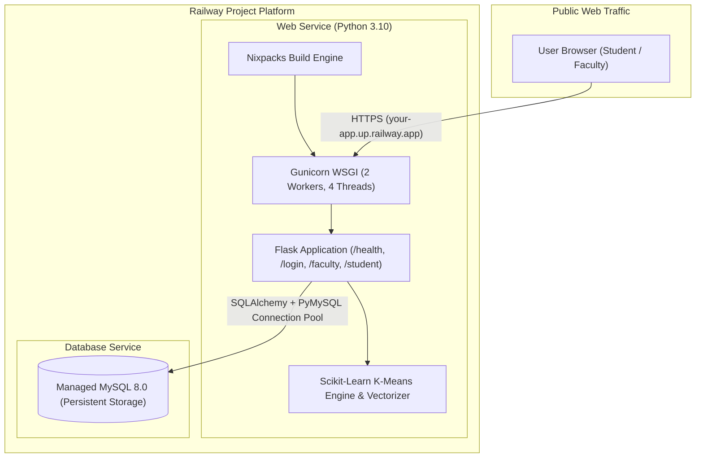

# 🚂 Railway Deployment Guide — AI Group Project Team Builder

This guide provides a step-by-step walkthrough for deploying the **AI Group Project Team Builder** to [Railway](https://railway.com/) with a production **MySQL** database, **Gunicorn** WSGI application server, **Scikit-learn** machine learning pipeline, and automated health checks.

---

## 🏗️ Architecture Overview on Railway



---

## 📋 Prerequisites

1. A **Railway Account**: Sign up at [railway.com](https://railway.com/).
2. A **GitHub Account**: With this repository pushed to your GitHub.
3. (Optional) **Railway CLI**: Installed via `npm i -g @railway/cli` or `brew install railway`.

---

## 🚀 Step-by-Step Deployment Instructions

### Step 1: Push Project to GitHub

Ensure all deployment configuration files are committed to your repository:
- [`Procfile`](file:///c:/Users/avadh/OneDrive/Desktop/MINIPRO/Procfile)
- [`railway.toml`](file:///c:/Users/avadh/OneDrive/Desktop/MINIPRO/railway.toml)
- [`gunicorn.conf.py`](file:///c:/Users/avadh/OneDrive/Desktop/MINIPRO/gunicorn.conf.py)
- [`requirements.txt`](file:///c:/Users/avadh/OneDrive/Desktop/MINIPRO/requirements.txt)
- [`runtime.txt`](file:///c:/Users/avadh/OneDrive/Desktop/MINIPRO/runtime.txt)
- [`.env.example`](file:///c:/Users/avadh/OneDrive/Desktop/MINIPRO/.env.example)

```bash
git add .
git commit -m "Prepare AI Team Builder for Railway deployment with Gunicorn and MySQL"
git push origin main
```

---

### Step 2: Create a New Project on Railway

1. Open your [Railway Dashboard](https://railway.com/dashboard).
2. Click **"New Project"**.
3. Select **"Provision MySQL"** to add a managed MySQL database instance first.
   - Railway will provision a dedicated MySQL 8 container with persistent volume storage.

---

### Step 3: Deploy the Web Service

1. In the same Railway project canvas, click **"+ Create"** or **"New Service"**.
2. Select **"GitHub Repo"** and choose your repository: `AI-Group-Project-Team-Builder` (or your repo name).
3. Railway will automatically detect the Python environment via Nixpacks using `requirements.txt` and `Procfile` / `railway.toml`.

---

### Step 4: Configure Environment Variables

1. Click on your **Web Service** in Railway and navigate to the **"Variables"** tab.
2. Click **"Add Variable"** or **"New Variable"** and configure:

| Variable Name | Value / Reference | Description |
| :--- | :--- | :--- |
| `DATABASE_URL` | `${{ MySQL.DATABASE_URL }}` | Links to your Railway MySQL database (or paste the MySQL connection URL). The app automatically converts `mysql://` to `mysql+pymysql://`. |
| `SECRET_KEY` | `generate-a-strong-random-key-here` | Secret key for encrypted Flask sessions. |
| `AUTO_SEED` | `true` | Automatically creates database tables and seeds 24 student profiles + 5 capstone projects on first boot. |
| `WEB_CONCURRENCY` | `2` | Number of Gunicorn worker processes. |
| `GUNICORN_THREADS` | `4` | Concurrency threads per worker. |
| `LOG_LEVEL` | `INFO` | Application log output verbosity. |

> [!NOTE]
> Railway automatically sets the `PORT` environment variable (e.g. `PORT=5000` or dynamic). Gunicorn is configured via [`gunicorn.conf.py`](file:///c:/Users/avadh/OneDrive/Desktop/MINIPRO/gunicorn.conf.py) to automatically bind to `0.0.0.0:$PORT`.

---

### Step 5: Generate a Public Domain

1. In your Web Service settings, go to the **"Networking"** section.
2. Under **"Public Networking"**, click **"Generate Domain"**.
3. Railway will assign an HTTPS domain (e.g., `https://ai-team-builder-production.up.railway.app`).

---

### Step 6: Verify Health Check & Production Logs

1. Go to the **"Deployments"** tab and click on the active deployment.
2. Check the build and deploy logs:
   ```text
   [INFO] Connected to MySQL on ... (railway)
   AUTO_SEED=true detected. Seeding database...
   Database seeding completed successfully.
   [INFO] Starting gunicorn 21.2.0
   [INFO] Listening at: http://0.0.0.0:xxxx
   [INFO] Using worker: gthread
   [INFO] Booting worker with pid: xxx
   ```
3. Open the health check endpoint in your browser:
   `https://your-app.up.railway.app/health`
   Expected response:
   ```json
   {
     "status": "healthy",
     "database": "connected",
     "database_type": "mysql",
     "service": "AI Group Project Team Builder",
     "environment": "production",
     "version": "1.0.0"
   }
   ```

---

## 🧪 Post-Deployment Feature Verification Checklist

Once deployed, verify all major workflows using the default accounts:

### 1. Authentication & Security
- [ ] Visit `https://your-app.up.railway.app/login`
- [ ] Log in as Faculty: `faculty@college.edu` / `Faculty@123`
- [ ] Log in as Student: `alex.chen@college.edu` / `Student@123`
- [ ] Test student self-registration at `/register`

### 2. Student Profile Management
- [ ] Navigate to `/student/profile`
- [ ] Update skills with 5-dot proficiency meters, domain interests, and availability slots
- [ ] Verify profile completeness progress bar updates to 100%

### 3. Faculty Project Creation & Management
- [ ] Navigate to `/faculty/projects`
- [ ] Create a new project specification with required technical skills, min proficiency, and role headcounts
- [ ] Verify project appears in catalog with color-coded domain tag

### 4. Algorithmic Team Generation
- [ ] Navigate to `/generation/<project_id>`
- [ ] **Approach A (Baseline)**: Adjust heuristic weight sliders (40% skills, 20% interests, 15% experience, 15% availability, 10% roles) and generate teams.
- [ ] **Approach B (AI/ML K-Means)**: Select cluster count ($K=4$), fit Scikit-Learn model, and generate complementary teams with explainable rationales.

### 5. Side-by-Side Comparison Dashboard
- [ ] Navigate to `/comparison/<project_id>`
- [ ] Verify the **Chart.js multi-dimensional graph** renders the 6 evaluation axes.
- [ ] Verify the **Mathematical Evaluation Metrics Table** calculates and displays deltas ($\Delta$) across all 10 observable metrics.

### 6. Team Review & Manual Overrides
- [ ] Navigate to `/generation/review/<run_id>`
- [ ] Test role override dropdown (updates database immediately via REST API)
- [ ] Test team reassignment dropdown
- [ ] Click **"Approve & Finalize Teams"** to publish teams to student dashboards

### 7. Exporting Reports
- [ ] Download final assignments CSV: `/reports/<project_id>/export/teams`
- [ ] Download algorithmic evaluation CSV: `/reports/<project_id>/export/comparison`
- [ ] Confirm CSV files download cleanly with accurate UTF-8 headers

---

## 🛠️ Troubleshooting & Frequently Asked Questions

### 1. `OperationalError: (pymysql.err.OperationalError) (2003, "Can't connect to MySQL server")`
- **Cause**: The web service cannot reach the MySQL database, or `DATABASE_URL` is pointing to an unlinked service.
- **Fix**: In Railway, verify your variable is set to `${{ MySQL.DATABASE_URL }}` or use the private internal connection string (`mysql.railway.internal:3306`).

### 2. `NoSuchModuleError: Can't load plugin: sqlalchemy.dialects:mysql`
- **Cause**: SQLAlchemy requires the `pymysql` driver dialect (`mysql+pymysql://`), whereas Railway provides `mysql://`.
- **Fix**: Our [`config.py`](file:///c:/Users/avadh/OneDrive/Desktop/MINIPRO/config.py) automatically detects `mysql://` and converts it to `mysql+pymysql://`. Ensure `pymysql>=1.1.0` is present in `requirements.txt`.

### 3. How to manually run database seeding on Railway
If you did not enable `AUTO_SEED=true`, you can seed the database via Railway CLI:
```bash
railway run python -m database.seed_data
```
Or via the Flask CLI command:
```bash
railway run flask seed-db
```

### 4. Ephemeral Filesystem Notice
- Railway containers have ephemeral local filesystems.
- All student profiles, academic projects, teams, assignments, and evaluation results are permanently persisted in the **Railway MySQL database**.
- Cluster model summaries are stored in MySQL `model_runs.features_json`, ensuring that all dashboards and evaluation graphs display accurately even across container redeployments.
